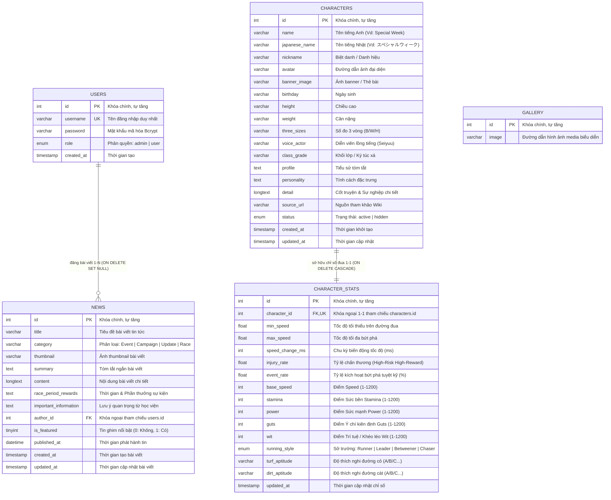
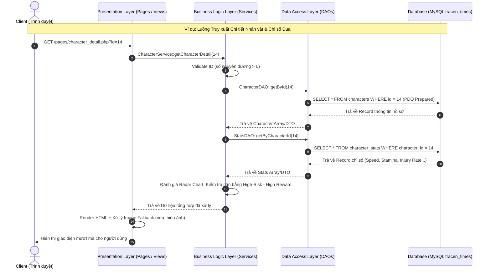

# TÀI LIỆU THIẾT KẾ KIẾN TRÚC 3 LỚP & NÂNG CẤP HỆ THỐNG TRACENTIMES

**Vị trí dự án:** `c:\xampp\htdocs\TracenTimes`  
**Chủ đề:** Cổng thông tin tin tức, hồ sơ nhân vật & mô phỏng đua ngựa Umamusume Pretty Derby.

---

## 1. Kiến Trúc 3 Lớp (3-Tier Architecture)

Hệ thống được thiết kế theo đúng chuẩn mô hình 3 lớp nhằm tách biệt rõ ràng trách nhiệm, dễ bảo trì, dễ mở rộng và dễ giải thích trong đồ án:

```mermaid
flowchart TD
    subgraph Presentation_Layer["1. TẦNG TRÌNH DIỄN (Presentation Layer / Views)"]
        UI_Home["Trang chủ (index.php)"]
        UI_News["Tin tức (News List & Detail)"]
        UI_Chars["Hồ sơ nhân vật (Char List & Detail)"]
        UI_Race["Đua ngựa Grand Derby (racing.php)"]
        UI_Admin["Admin Dashboard & CRUD (admin/*.php)"]
    end

    subgraph Business_Logic_Layer["2. TẦNG NGHIỆP VỤ (Business Logic Layer / Services)"]
        NewsService["NewsService<br/>(Lọc tin, validate bài viết, định dạng ngày, phân trang)"]
        CharService["CharacterService<br/>(Validate hồ sơ, xử lý upload ảnh, tìm kiếm)"]
        StatsService["StatsService<br/>(Cân bằng tốc độ, kiểm tra min/max, thuật toán chấn thương)"]
        AuthService["AuthService<br/>(Kiểm tra đăng nhập, mã hóa bcrypt, phân quyền Admin)"]
    end

    subgraph Data_Access_Layer["3. TẦNG TRUY CẬP DỮ LIỆU (Data Access Layer / DAOs)"]
        NewsDAO["NewsDAO<br/>(CRUD bảng news)"]
        CharDAO["CharacterDAO<br/>(CRUD bảng characters)"]
        StatsDAO["StatsDAO<br/>(CRUD bảng character_stats)"]
        UserDAO["UserDAO<br/>(CRUD bảng users)"]
        DB["Database Singleton<br/>(Kết nối PDO an toàn, Prepared Statements)"]
    end

    subgraph Database["CƠ SỞ DỮ LIỆU (MySQL / MariaDB)"]
        DB_News[("Bảng news")]
        DB_Chars[("Bảng characters")]
        DB_Stats[("Bảng character_stats")]
        DB_Users[("Bảng users")]
    end

    Presentation_Layer -->|Gọi xử lý nghiệp vụ| Business_Logic_Layer
    Business_Logic_Layer -->|Yêu cầu dữ liệu| Data_Access_Layer
    Data_Access_Layer -->|Thực thi SQL qua PDO| Database
    Database -.->|Trả kết quả| Data_Access_Layer
    Data_Access_Layer -.->|Trả Object/Array DTO| Business_Logic_Layer
    Business_Logic_Layer -.->|Trả dữ liệu đã xử lý| Presentation_Layer
```



### Chi tiết các tầng:
1. **Presentation Layer (Tầng Trình diễn / Giao diện)**:
   - Chỉ đảm nhiệm việc nhận request từ người dùng (HTTP GET/POST), gọi xuống Service tương ứng và render HTML/CSS/JS.
   - Không chứa bất kỳ câu lệnh SQL `SELECT/INSERT/UPDATE` nào.
2. **Business Logic Layer (Tầng Nghiệp vụ / Service)**:
   - Đảm nhiệm việc kiểm tra dữ liệu (validation), logic tính toán (ví dụ: kiểm tra `min_speed < max_speed`, tỷ lệ chấn thương `0 <= injury_rate <= 1`), kiểm tra quyền hạn (Admin check), xử lý upload file ảnh.
   - Không chứa mã HTML và không thực thi SQL trực tiếp.
3. **Data Access Layer (Tầng Truy cập Dữ liệu / DAO)**:
   - Chuyên trách duy nhất việc giao tiếp với Database qua PDO với Prepared Statements chống SQL Injection 100%.
   - Cung cấp các phương thức CRUD chuẩn mực: `getAll()`, `getById($id)`, `create($data)`, `update($id, $data)`, `delete($id)`.

---

## 2. Cấu Trúc Thư Mục Module Hóa

```text
c:\xampp\htdocs\TracenTimes\
│
├── config/                      # Cấu hình hệ thống & CSDL
│   ├── database.php             # Cấu hình thông số DB (host, dbname, user, pass)
│   └── app.php                  # Hằng số toàn cục (BASE_URL, SITE_NAME)
│
├── core/                        # Tầng lõi dùng chung (Core Engine)
│   ├── Database.php             # [DAL] Quản lý kết nối PDO Singleton
│   ├── Auth.php                 # [BLL] Middleware kiểm tra đăng nhập & phân quyền admin
│   └── Helper.php               # Các hàm bổ trợ (format ngày, upload file, cắt chuỗi)
│
├── docs/                        # THƯ MỤC TÀI LIỆU THIẾT KẾ (Giữ nguyên bên ngoài)
│   ├── architecture_3_tier_plan.md
│   └── ...
│
├── sql/                         # THƯ MỤC CHUYÊN LÀM VIỆC VỚI CÁC FILE SQL
│   ├── 00_full_database_init.sql # [MASTER] Khởi tạo toàn bộ Database & Seed Data 1-click
│   ├── 01_schema_init.sql       # Script tạo cấu trúc database mới chuẩn hóa
│   ├── 02_migration.sql         # Script chuyển dữ liệu cũ sang cấu trúc tách bảng mới
│   ├── 03_seed_data.sql         # Dữ liệu mẫu nhân vật, chỉ số và tin tức
│   ├── run_sync.php             # Script CLI chạy đồng bộ Wiki từ dòng lệnh
│   └── legacy/                  # Thư mục lưu trữ các script SQL cũ phục vụ đối chiếu
│
├── modules/                     # PHÂN CHIA CÁC MODULE THEO THƯ MỤC (3 LỚP)
│   ├── auth/                    # Module Xác thực (Đăng nhập, Đăng ký, Đăng xuất)
│   │   ├── AuthDAO.php          # [DAL]
│   │   └── AuthService.php      # [BLL]
│   │
│   ├── news/                    # Module Tin tức (News Portal)
│   │   ├── NewsDAO.php          # [DAL]
│   │   └── NewsService.php      # [BLL]
│   │
│   ├── characters/              # Module Hồ sơ nhân vật (Character Profiles)
│   │   ├── CharacterDAO.php     # [DAL]
│   │   └── CharacterService.php # [BLL]
│   │
│   ├── stats/                   # Module Chỉ số & Đua ngựa (Stats & Racing)
│   │   ├── StatsDAO.php         # [DAL]
│   │   └── StatsService.php     # [BLL]
│   │
│   ├── wiki/                    # Module Tích Hợp Umamusu Wiki (Wiki Integration)
│   │   ├── WikiSyncService.php  # [BLL] Bóc tách & đồng bộ tin tức, banners và characters
│   │   └── cache_main_page.html # Cache mã nguồn Wiki Main Page đảm bảo luôn sẵn sàng
│   │
│   └── admin/                   # Module Quản trị (Admin Control Center)
│       ├── AdminService.php     # [BLL] Thống kê Dashboard & Điều phối
│       ├── index.php            # [PL] Trang Dashboard tổng quan
│       ├── wiki_sync.php        # [PL] Trung tâm Đồng bộ Umamusu Wiki một chạm
│       ├── news_manage.php      # [PL] Quản lý tin tức (Danh sách, thêm, sửa, xóa)
│       ├── news_form.php        # [PL] Form thêm/sửa tin tức
│       ├── char_manage.php      # [PL] Quản lý hồ sơ nhân vật
│       ├── char_form.php        # [PL] Form thêm/sửa hồ sơ nhân vật
│       ├── stats_manage.php     # [PL] Quản lý tốc độ, tỷ lệ chấn thương
│       └── stats_form.php       # [PL] Form tinh chỉnh chỉ số & thuộc tính
│
├── pages/                       # [PL] Giao diện người dùng (Client Pages)
│   ├── news.php                 # Danh sách tin tức
│   ├── news_detail.php          # Chi tiết tin tức
│   ├── characters_list.php      # Danh sách nhân vật
│   ├── character_detail.php     # Chi tiết nhân vật (Tab Profile + Tab Stats)
│   ├── racing.php               # Đua ngựa Grand Derby Cup
│   ├── login.php                # Đăng nhập
│   ├── register.php             # Đăng ký
│   ├── logout.php               # Đăng xuất
│   └── 404.php                  # Trang báo lỗi 404
│
├── sections/                    # [PL] Các thành phần trang chủ
│   ├── banner_video.php
│   ├── news.php
│   ├── characters.php
│   ├── racing_section.php
│   ├── media_gallery.php
│   └── play_modal.php
│
├── includes/                    # [PL] Header & Footer tái sử dụng
│   ├── header.php               # Header chính (có nút Admin nếu là admin)
│   ├── footer.php               # Footer chính
│   ├── admin_header.php         # Header trang quản trị
│   └── admin_footer.php         # Footer trang quản trị
│
├── css/                         # Stylesheet hệ thống
├── js/                          # Javascript hệ thống
├── media/                       # Thư viện ảnh & video
│   ├── img/
│   │   ├── characters/          # Ảnh đại diện nhân vật
│   │   ├── news/                # Ảnh bài viết tin tức
│   │   └── galleries/
│   └── video/
│
└── index.php                    # Trang chủ cổng thông tin TracenTimes
```

---

## 3. Thiết Kế Cơ Sở Dữ Liệu Tách Biệt & Bổ Sung Các Trường Mới

### 3.1. Bảng `characters` (Chuyên lưu trữ Thông tin & Hồ sơ cá nhân)
- `id` (INT PK AI)
- `name` (VARCHAR(255) NOT NULL - Tên nhân vật, vd: 'Special Week')
- `japanese_name` (VARCHAR(255) - Tên tiếng Nhật, vd: 'スペシャルウィーク')
- `nickname` (VARCHAR(255) - Danh hiệu/Biệt danh, vd: 'Japanese Best Uma')
- `avatar` (VARCHAR(500) NOT NULL - Đường dẫn ảnh đại diện)
- `banner_image` (VARCHAR(500) - Ảnh nền/thẻ lớn)
- `birthday` (VARCHAR(100) - Ngày sinh)
- `height` (VARCHAR(50) - Chiều cao)
- `weight` (VARCHAR(50) - Cân nặng)
- `three_sizes` (VARCHAR(100) - Số đo ba vòng)
- `voice_actor` (VARCHAR(255) - Diễn viên lồng tiếng Seiyuu)
- `class_grade` (VARCHAR(100) - Khối lớp / Ký túc xá)
- `profile` (TEXT - Tiểu sử tóm tắt)
- `personality` (TEXT - Tính cách đặc trưng)
- `detail` (LONGTEXT - Chi tiết cốt truyện / mở rộng)
- `source_url` (VARCHAR(500) - Nguồn tham khảo Fandom/Wiki)
- `status` (ENUM('active','hidden') DEFAULT 'active')
- `created_at`, `updated_at` (TIMESTAMP)

### 3.2. Bảng `character_stats` (Chuyên lưu trữ Chỉ số Đua, Tốc độ & Chấn thương)
*Quan hệ 1-1 với `characters` qua `character_id` (Khóa ngoại ON DELETE CASCADE).*

- `id` (INT PK AI)
- `character_id` (INT NOT NULL UNIQUE - FK -> `characters.id`)
- `min_speed` (FLOAT DEFAULT 0.2 - Tốc độ tối thiểu trên đường đua)
- `max_speed` (FLOAT DEFAULT 1.0 - Tốc độ tối đa trên đường đua)
- `speed_change_ms` (INT DEFAULT 3000 - Chu kỳ biến động tốc độ tính bằng ms)
- `injury_rate` (FLOAT DEFAULT 0.05 - Tỷ lệ chấn thương: 0.00 đến 1.00, vd: 0.05 = 5%)
- `event_rate` (FLOAT DEFAULT 5.0 - Tỷ lệ kích hoạt bứt phá / tuyệt kỹ %)
- `base_speed` (INT DEFAULT 100 - Điểm Speed 1-1200)
- `stamina` (INT DEFAULT 100 - Điểm Sức bền Stamina 1-1200)
- `power` (INT DEFAULT 100 - Điểm Sức mạnh Power 1-1200)
- `guts` (INT DEFAULT 100 - Điểm Ý chí Guts 1-1200)
- `wit` (INT DEFAULT 100 - Điểm Trí tuệ/Khéo léo Wisdom 1-1200)
- `running_style` (ENUM('Runner','Leader','Betweener','Chaser') DEFAULT 'Leader')
- `turf_aptitude` (VARCHAR(10) DEFAULT 'A' - Độ thích nghi đường cỏ)
- `dirt_aptitude` (VARCHAR(10) DEFAULT 'G' - Độ thích nghi đường cát)
- `updated_at` (TIMESTAMP)

### 3.3. Bảng `news` (Chuẩn hóa trường tin tức)
- `id` (INT PK AI)
- `title` (VARCHAR(500) NOT NULL - Tiêu đề tin tức)
- `category` (VARCHAR(100) DEFAULT 'Event' - Event, Update, Campaign, Race, Maintenance)
- `thumbnail` (VARCHAR(500) - Ảnh bìa tin tức)
- `summary` (TEXT - Tóm tắt nội dung)
- `content` (LONGTEXT - Bài viết chi tiết)
- `race_period_rewards` (TEXT - Khối thông tin thời gian & phần thưởng)
- `important_information` (TEXT - Khối thông tin lưu ý quan trọng)
- `author_id` (INT - FK -> `users.id`)
- `is_featured` (TINYINT(1) DEFAULT 0 - Tin ghim nổi bật)
- `published_at` (DATETIME NOT NULL)
- `created_at`, `updated_at` (TIMESTAMP)

### 3.4. Bảng `gallery` (Thư viện media biểu diễn)
- `id` (INT PK AI)
- `image` (VARCHAR(500) NOT NULL - Đường dẫn hình ảnh)

---

## 4. Sơ Đồ Quan Hệ Thực Thể (ERD - Entity Relationship Diagram)

Hệ thống cơ sở dữ liệu `tracen_times` được thiết kế theo chuẩn dạng chuẩn 3 (3NF), tách biệt rõ ràng giữa thông tin tiểu sử cá nhân và chỉ số đua, đảm bảo toàn vẹn dữ liệu thông qua các ràng buộc khóa ngoại (Foreign Keys):



---

## 5. Sơ Đồ Quy Trình Nghiệp Vụ & Luồng Hoạt Động Hệ Thống (Workflows)

### 5.1. Luồng nghiệp vụ tổng thể (User & Admin Business Flow)

```mermaid
flowchart TD
    Start(["Khách / Người dùng truy cập TracenTimes"]) --> Home["Trang chủ (index.php)"]

    subgraph Guest_Flow["1. LUỒNG NGƯỜI DÙNG & HUẤN LUYỆN VIÊN (User Flow)"]
        Home --> ViewNews["Xem Tin tức & Sự kiện Scout<br/>(pages/news.php)"]
        ViewNews --> NewsDetail["Chi tiết Tin tức<br/>(pages/news_detail.php)"]

        Home --> ViewChars["Xem Hồ sơ Nhân vật<br/>(pages/characters_list.php)"]
        ViewChars --> CharDetail["Chi tiết Nhân vật & Biểu đồ Radar<br/>(pages/character_detail.php)"]

        Home --> Racing["Mô phỏng Đua ngựa Grand Derby<br/>(pages/racing.php)"]
        Racing --> SelectUma["Huấn luyện viên chọn Umamusume"]
        SelectUma --> RaceEngine["Racing Engine khởi chạy<br/>- Tính biến động tốc độ (min_speed -> max_speed)<br/>- Kiểm tra tỷ lệ chấn thương (injury_rate)<br/>- Kích hoạt tuyệt kỹ bứt phá (event_rate)"]
        RaceEngine --> FinishRace["Cán đích & Trao cúp vô địch"]
    end

    subgraph Auth_Flow["2. LUỒNG XÁC THỰC & PHÂN QUYỀN (Auth Flow)"]
        Home --> Login["Trang Đăng nhập (pages/login.php)"]
        Login --> AuthCheck{"Xác thực Bcrypt & Vai trò?"}
        AuthCheck -->|Sai thông tin| LoginFail["Báo lỗi đăng nhập"]
        AuthCheck -->|User thường (Trainer)| UserSuccess["Đăng nhập thành công<br/>(Tham gia giải đua & Lưu hồ sơ)"]
        AuthCheck -->|Admin| AdminCenter["Chuyển hướng vào Admin Control Center"]
    end

    subgraph Admin_Flow["3. LUỒNG QUẢN TRỊ VIÊN 3 LỚP (Admin Management Flow)"]
        AdminCenter --> AdminDash["Admin Dashboard (modules/admin/index.php)<br/>Thống kê tổng quan Nhân vật, Tin tức, Tốc độ"]
        
        AdminDash --> ManageNews["Quản lý Tin tức (news_manage.php)<br/>Thêm / Sửa / Xóa bài viết"]
        AdminDash --> ManageChars["Quản lý Nhân vật (char_manage.php)<br/>Thêm / Sửa / Xóa hồ sơ"]
        AdminDash --> ManageStats["Quản lý Chỉ số Đua (stats_manage.php)<br/>Cân bằng tốc độ & Tỷ lệ chấn thương"]
        AdminDash --> WikiSync["Trung tâm Đồng bộ Wiki (wiki_sync.php)<br/>Một chạm cào dữ liệu từ umamusu.wiki"]
        
        WikiSync --> WikiSyncService["WikiSyncService<br/>Bóc tách HTML & JSON"]
        WikiSyncService --> SaveDB["Tự động lưu vào Database qua CharacterDAO & NewsDAO"]
    end
```

### 5.2. Luồng xử lý kỹ thuật 3 lớp theo chuẩn Request/Response (3-Tier Flow)



