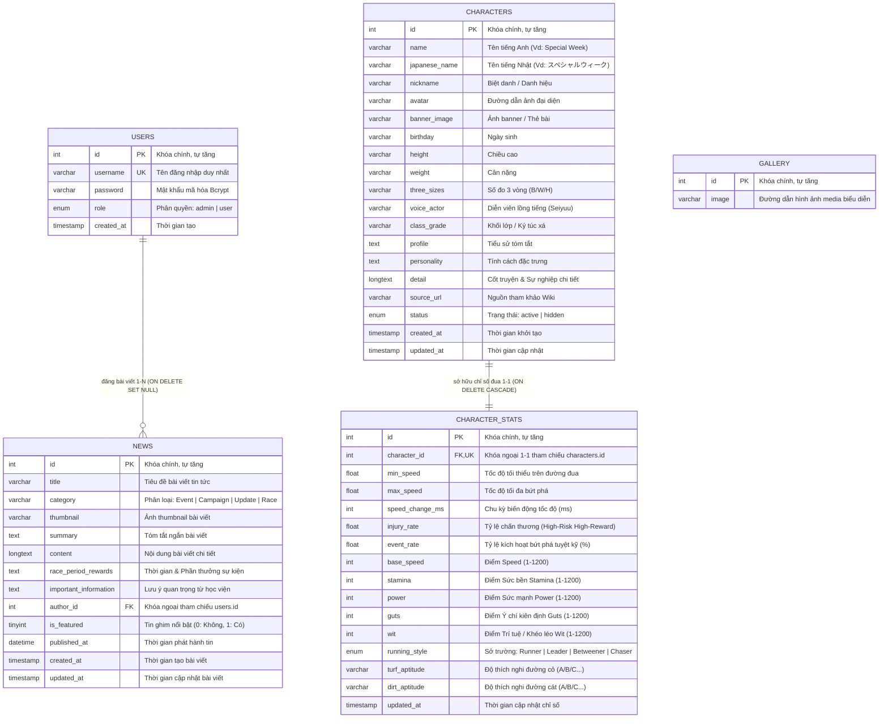
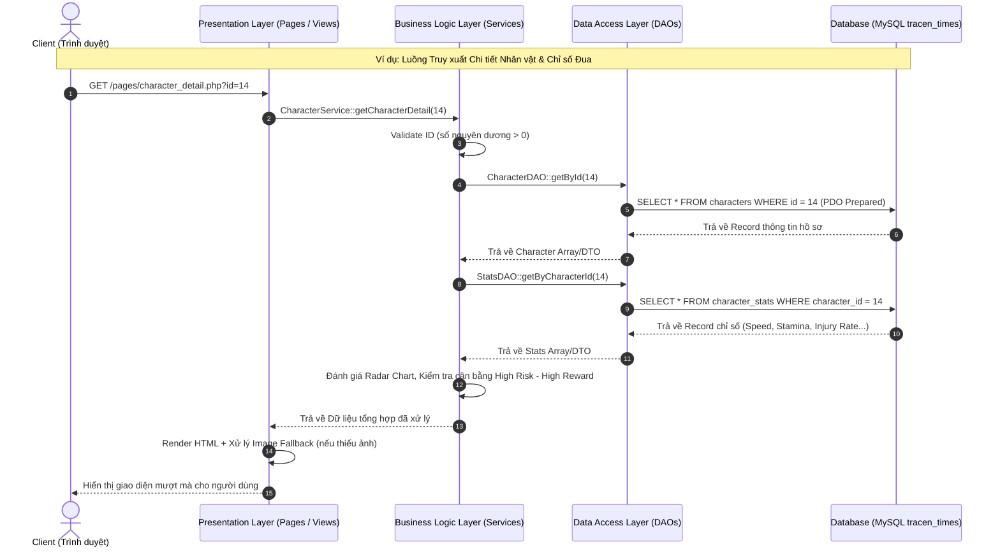

# SƠ ĐỒ THIẾT KẾ CƠ SỞ DỮ LIỆU & QUY TRÌNH NGHIỆP VỤ TRACENTIMES

Tài liệu này cung cấp toàn bộ sơ đồ ERD (Entity Relationship Diagram) và các luồng quy trình nghiệp vụ (Workflows) của hệ thống TracenTimes bằng định dạng mã nguồn **Mermaid**.

---

## 1. Sơ Đồ Quan Hệ Thực Thể (ERD - Entity Relationship Diagram)



---

## 2. Sơ Đồ Quy Trình Nghiệp Vụ Tổng Thể (Business Workflow)

```mermaid
flowchart TD
    Start(["Khách / Người dùng truy cập TracenTimes"]) --> Home["Trang chủ (index.php)"]

    subgraph Guest_Flow["1. LUỒNG NGƯỜI DÙNG & HUẤN LUYỆN VIÊN (User Flow)"]
        Home --> ViewNews["Xem Tin tức & Sự kiện Scout<br/>(pages/news.php)"]
        ViewNews --> NewsDetail["Chi tiết Tin tức<br/>(pages/news_detail.php)"]

        Home --> ViewChars["Xem Hồ sơ Nhân vật<br/>(pages/characters_list.php)"]
        ViewChars --> CharDetail["Chi tiết Nhân vật & Biểu đồ Radar<br/>(pages/character_detail.php)"]

        Home --> Racing["Mô phỏng Đua ngựa Grand Derby<br/>(pages/racing.php)"]
        Racing --> SelectUma["Huấn luyện viên chọn Umamusume"]
        SelectUma --> RaceEngine["Racing Engine khởi chạy<br/>- Tính biến động tốc độ (min_speed -> max_speed)<br/>- Kiểm tra tỷ lệ chấn thương (injury_rate)<br/>- Kích hoạt tuyệt kỹ bứt phá (event_rate)"]
        RaceEngine --> FinishRace["Cán đích & Trao cúp vô địch"]
    end

    subgraph Auth_Flow["2. LUỒNG XÁC THỰC & PHÂN QUYỀN (Auth Flow)"]
        Home --> Login["Trang Đăng nhập (pages/login.php)"]
        Login --> AuthCheck{"Xác thực Bcrypt & Vai trò?"}
        AuthCheck -->|Sai thông tin| LoginFail["Báo lỗi đăng nhập"]
        AuthCheck -->|User thường (Trainer)| UserSuccess["Đăng nhập thành công<br/>(Tham gia giải đua & Lưu hồ sơ)"]
        AuthCheck -->|Admin| AdminCenter["Chuyển hướng vào Admin Control Center"]
    end

    subgraph Admin_Flow["3. LUỒNG QUẢN TRỊ VIÊN 3 LỚP (Admin Management Flow)"]
        AdminCenter --> AdminDash["Admin Dashboard (modules/admin/index.php)<br/>Thống kê tổng quan Nhân vật, Tin tức, Tốc độ"]
        
        AdminDash --> ManageNews["Quản lý Tin tức (news_manage.php)<br/>Thêm / Sửa / Xóa bài viết"]
        AdminDash --> ManageChars["Quản lý Nhân vật (char_manage.php)<br/>Thêm / Sửa / Xóa hồ sơ"]
        AdminDash --> ManageStats["Quản lý Chỉ số Đua (stats_manage.php)<br/>Cân bằng tốc độ & Tỷ lệ chấn thương"]
        AdminDash --> WikiSync["Trung tâm Đồng bộ Wiki (wiki_sync.php)<br/>Một chạm cào dữ liệu từ umamusu.wiki"]
        
        WikiSync --> WikiSyncService["WikiSyncService<br/>Bóc tách HTML & JSON"]
        WikiSyncService --> SaveDB["Tự động lưu vào Database qua CharacterDAO & NewsDAO"]
    end
```

---

## 3. Sơ Đồ Luồng Xử Lý Kỹ Thuật Chuẩn 3 Lớp (3-Tier Sequence Diagram)


